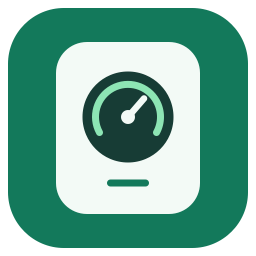

# vine local

Local Home Assistant control for Vine Wi-Fi thermostats. Sign in with your existing
Vine account once, choose your thermostat, then control it over your LAN.
No Smart Life migration, Tuya developer account or Mac needed.

## what it does

- **Local control.** Temperature, heat/cool mode, fan and hold controls, with state read back after each command.
- **Automatic setup.** Retrieves the device key and product schema from your Vine account. Discovers the LAN address and detects the protocol.
- **Product-aware controls.** Uses each product's datapoint IDs, scales, temperature bounds and supported modes. Optional controls appear only when its schema supports them.
- **One shared connection.** Entities share a 30-second poll. Requests are serialized and sockets close after use.

## install

Add `https://github.com/bryanthaboi/vine-local` as a **custom repository**, type
**Integration**, in HACS (or Marketplace on newer Home Assistant versions). Download **Vine Local**, then restart Home Assistant.
For the initial preview release, enable beta versions if HACS does not offer it.

[Open this repository in HACS](https://my.home-assistant.io/redirect/hacs_repository/?owner=bryanthaboi&repository=vine-local&category=integration)

Then open **Settings → Devices & services → Add integration → Vine Local**:

1. Choose **Sign in with Vine** and enter the email/password you use in the Vine Thermostat app.
2. Select your account's country calling code and region. US accounts use `1` and `us`.
3. Choose your thermostat and confirm its LAN address. If discovery cannot cross your VM/subnet, enter the IP from your router.

Protocol detection is automatic. An override is available inside **Advanced**.
Reserve the thermostat's IP in your router and avoid a second local Tuya integration
polling the same device.

manual installation or local-key setup

Download the release ZIP and copy `custom_components/vine_local` into
`/config/custom_components/vine_local`. Validate your Home Assistant configuration,
then restart Core and add **Vine Local**.

**Enter a local key manually** skips cloud sign-in. Manual setup uses the ST300
profile by default. Other models need their exported product schema under
**Advanced → Product schema**. See [standalone tools](docs/tools.md).

## supported devices

| Device | Status |
| --- | --- |
| Vine ST300, product `qn4upx5kzja3rg1l` | Tested on hardware with Tuya LAN 3.5 |
| Other Tuya-based Vine Wi-Fi thermostats | Schema-based support, needs reports from owners |
| Devices with missing or unfamiliar thermostat schemas | Detected during account setup, controls rejected |
| Smart Life/Tuya Smart accounts, non-Vine brands, older non-Tuya Vine devices | Not supported by Vine account sign-in |

Other models do **not** inherit the ST300's datapoint numbers. A compatible schema
must identify readable current temperature, writable target temperature and power,
and explicit heat/cool modes. See [device support](docs/devices.md).

On the ST300, local reads and same-value target-temperature writes have been tested
both directly and through Home Assistant. Fresh Vine sign-in and automatic key
retrieval also work. Mode, fan, hold and automatic-mode range changes have code
coverage but have not been exercised on a physical HVAC system. Internet-blocked
operation and long-term reliability have not been tested. Only the US account
region has been tested. CAPTCHA/MFA sign-in challenges are not supported.

## privacy

Your login goes directly over HTTPS to the **Tuya servers used by the Vine app**,
only for Vine account authentication and setup. It is never sent to the integration
developer. The integration does not save your password or cloud session.

Home Assistant saves the selected device's local key, ID, LAN address, protocol
and product profile. Normal polling and control make no cloud requests. Your
thermostat may still contact Vine independently. See [privacy and diagnostics](docs/privacy.md).

## help and development

[Report a problem](https://github.com/bryanthaboi/vine-local/issues/new/choose)
with your model, firmware, Home Assistant version and integration diagnostics.
For an unsupported model, attach a product-schema export, not a raw device dump.
Never include a password, local key, account session or Home Assistant token.

- [Standalone Python tools](docs/tools.md)
- [Adding device support](docs/devices.md)
- [Contributing](CONTRIBUTING.md)
- [Publishing and releases](docs/publishing.md)

Uses [TinyTuya](https://github.com/jasonacox/tinytuya) for the Tuya LAN protocol.
Independent community integration, not affiliated with Vine, Tuya or Home Assistant.
